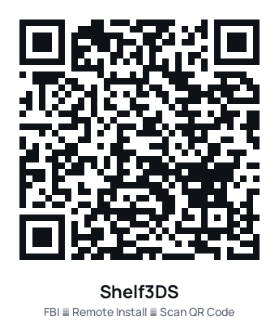

# Shelf3DS: Audiobookshelf for Nintendo 3DS

[](https://github.com/DarthTigerson/Shelf3DS/actions/workflows/build.yml)
[](https://github.com/DarthTigerson/Shelf3DS/releases/latest)

A native 3DS player for your self-hosted [Audiobookshelf](https://www.audiobookshelf.org/) server.
Browse your library with cover art, stream or download books, and keep your
place in sync with the ABS web and phone apps.

- Streams M4B/M4A (AAC-LC and HE-AAC) and MP3, including multi-file MP3 books
- Resumes where you left off; progress syncs to the server every 15 s, on pause, seek and chapter change
- Chapters, skip back/forward (10/15/30/60 s), 0.75–2× speed with pitch preserved, sleep timer (15–60 min or end of chapter)
- Offline downloads; progress made offline is queued and sent when you're back on Wi‑Fi
- Keeps playing with the lid closed when headphones are plugged in (screens off to save battery)
- Runs on Old 3DS / 2DS and New 3DS / New 2DS XL (fast CPU mode is enabled automatically on New models)

## Install



1. On the 3DS, open **FBI → Remote Install → Scan QR Code** and scan the code on the right.
   It always downloads the newest `shelf3ds.cia` from the
   [latest release](https://github.com/DarthTigerson/Shelf3DS/releases/latest).
   You can also download `shelf3ds.cia` yourself, copy it to the SD card and install it with FBI.
   `shelf3ds.3dsx` runs from the Homebrew Launcher.
2. **Audio needs the DSP firmware dump** (`sdmc:/3ds/dspfirm.cdc`). Most consoles set up with
   the standard hacking guide already have it. If the app says *"No audio: run DSP1…"*, run
   the **DSP1** homebrew once and restart Shelf3DS.

## First run

1. Open Shelf3DS from the HOME Menu.
2. **Server**: enter your server's address, for example `http://192.168.1.10:13378`, plus its base path
   if it has one (e.g. `http://192.168.1.10:13378/audiobookshelf`). Only plain `http://` on your home
   network is supported.
3. Enter your ABS **username** and **password**, then **Connect**. The password is never stored; the app keeps a
   refresh token in `sdmc:/3ds/shelf3ds/config.json`.

Tip: type `demo` as the server to try the interface without a server.

## Controls

| Where | Control | Action |
|---|---|---|
| Everywhere | Touch / D-pad / Circle Pad | Navigate |
| | A / B | Select / Back |
| | START + SELECT | Quit |
| Home | L / R | Switch tab (Continue · Library · Downloads · Settings) |
| | Y | Change sort (title, author, recently added) |
| | X | Search titles, authors, series |
| | SELECT | Refresh library |
| | START | Open Now Playing |
| Downloads tab | A / X / Y | Play / Delete / Resume a paused download |
| Now Playing | A | Play / pause |
| | ← / → | Skip back / forward |
| | L / R | Previous / next chapter |
| | X | Chapter list |
| | Y | Change speed |
| | SELECT | Sleep timer |
| | ↓ then ←/→, A | Pick a chip (speed, sleep, chapters, screen off) |
| | Drag the bar under the controls | Scrub within the chapter |

"Screen off" turns both screens off while you listen; press any button to wake them.
Closing the lid with headphones in keeps playing; without headphones the book pauses.

## Troubleshooting

- **"Can't reach the server"**: check the console is on the same Wi‑Fi and the server is running
  (open `http://<server>/audiobookshelf/status` in a browser on another device).
- **"No Audiobookshelf there"**: the address is missing its base path, e.g. `/audiobookshelf`.
- **"No audio: run DSP1…"**: see Install, step 2.
- Network problems are logged to `sdmc:/3ds/shelf3ds/debug.log` (kept under 256 KB).
- **Emulators**: Azahar runs the UI and plays downloaded books. Use its *Software* renderer:
  the default Vulkan renderer on macOS doesn't apply citro2d tints, so icons draw as white or black shapes.
  Azahar on macOS could not open network connections in testing, so test streaming on a real console.

## Files on the SD card

```
sdmc:/3ds/shelf3ds/
  config.json            server, user, settings, refresh token
  progress_queue.json    latest position per book (synced when online)
  debug.log              network diagnostics
  covers/<id>.jpg        cover cache
  moov/                  cached MP4 indexes for streamed M4B files
  books/<id>/            downloads (meta.json, 01.m4b ..., .done)
```

## Building

Requires Docker. The build image bundles devkitARM, libctru, citro2d, makerom and bannertool.

```sh
./build.sh          # shelf3ds.3dsx
./build.sh cia      # shelf3ds.3dsx + shelf3ds.cia
make -f Makefile.host test   # host unit + audio pipeline tests (macOS/Linux, needs ffmpeg)
```

`tools/make_art.py` regenerates the icon, banner and banner jingle; `tools/make_qr.py` the FBI QR code.

### Releases

CI (`.github/workflows/build.yml`) runs the tests and builds both packages on every push.
To publish a release, tag a version and push the tag. The version is taken from the tag:

```sh
git tag v1.0.1 && git push origin v1.0.1
```

The workflow builds `shelf3ds.cia` / `shelf3ds.3dsx` stamped with that version and attaches them
to a GitHub release. The QR code always points at the latest release.

## Credits and licences

Shelf3DS is MIT licensed (see `LICENSE`). It bundles:

- Helix fixed-point AAC decoder (RealNetworks, RPSL/RCSL), via the ESP8266Audio port
- [sonic](https://github.com/waywardgeek/sonic) time-stretching (Apache 2.0)
- [cJSON](https://github.com/DaveGamble/cJSON) (MIT), [stb_image](https://github.com/nothings/stb) (public domain)
- libmpg123 (LGPL 2.1), libctru, citro2d/citro3d (zlib)
- Manrope font (SIL Open Font License, `assets/fonts/OFL.txt`)
